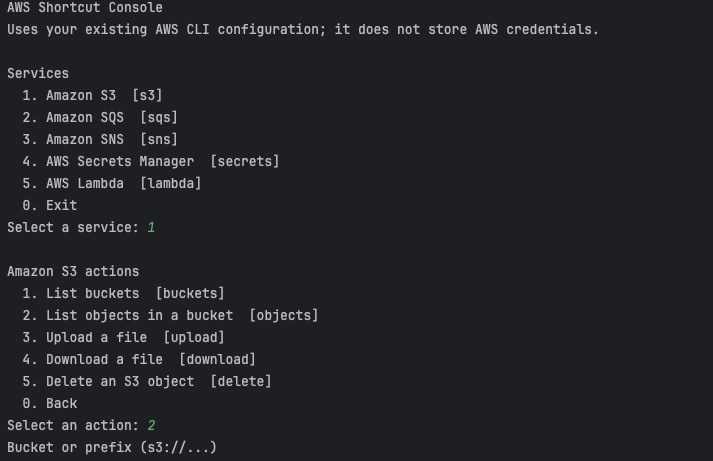
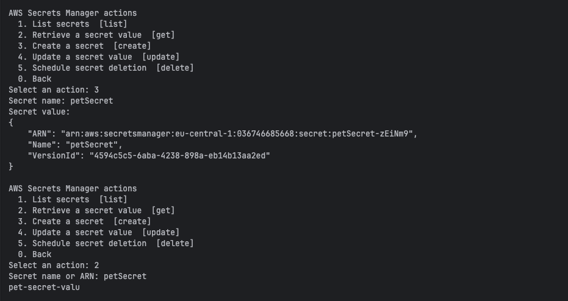
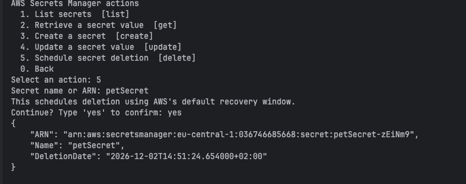
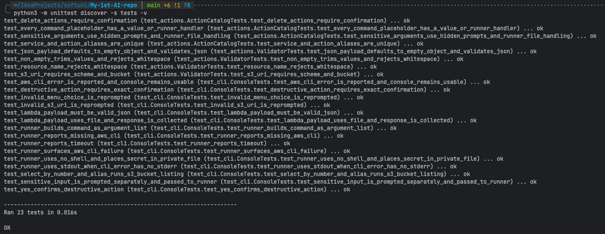

# AWS Shortcut Console — AI-Assisted Development Project

## Project idea and requirements

**AWS Shortcut Console** is a Python command-line app that makes a curated set of common AWS CLI operations easier to run. Instead of remembering full command syntax, the user selects an AWS service and action by number or short alias, enters the required resource values, and the app invokes the installed AWS CLI.

The first version supports S3 (buckets and objects, with sorting by name or last-modified date, upload/download, object deletion), SQS (queues and messages), SNS (topics, publish and subscribe), AWS Secrets Manager (list, retrieve, create, update and schedule deletion), and Lambda (list and invoke with JSON). It validates basic input formats, checks AWS CLI authentication at startup, confirms destructive actions and Lambda invocations, and uses the user's normal AWS CLI profile and credentials. Users must sign in with `aws login` or configure their AWS CLI credentials before running cloud actions. The app does not store credentials or attempt to wrap arbitrary shell commands. Python's standard library is used; there are no runtime dependencies beyond Python and AWS CLI v2.

## System architecture and development process

### 1. Supported operations and input validation

**Approach and reasoning.** A finite allow-list of useful operations keeps the tool easy to learn and prevents arbitrary command execution. Each service has numbered actions and short aliases. Validators catch common input mistakes before any cloud request is made.

**Workflow and AI assistance.** I asked for a Python console application for S3, SQS, SNS, Secrets Manager, and Lambda, with numbered menus and aliases. I then narrowed the initial scope to curated common operations rather than a wrapper for every AWS CLI command. The service/action catalog and validators live in `aws_shortcuts/actions.py`.

**Testing strategy.** Unit tests exercise service/action selection and invalid S3 URI/JSON input. The tests use no AWS account.

**Tool choice.** GitHub Copilot assisted with the catalog structure and validation cases. A declarative list of actions was chosen because it is small and makes the supported surface visible in one place.

### 2. Interactive console and confirmation

**Approach and reasoning.** The console separates navigation from command execution. Users can select by number or alias, go back with `0`, and must type `yes` to confirm resource deletions and Lambda invocation.

**Workflow and AI assistance.** I specified that changes should execute through AWS CLI, but destructive actions should require confirmation. Copilot helped implement an input-driven console that can be tested using fake input and a fake runner. User interaction is implemented in `aws_shortcuts/cli.py`.

**Testing strategy.** Tests cover number/alias selection, canceling a delete, confirming a delete, invalid-value re-prompting, and hidden input for a secret.

**Tool choice.** GitHub Copilot was useful for implementing the repetitive menu flow while keeping the interaction logic injectable for deterministic tests.

### 3. AWS CLI execution and sensitive values

**Approach and reasoning.** The app delegates credentials, signing, regions, and AWS API communication to AWS CLI v2. It builds an argument list and invokes `subprocess.run` without a shell. Secret values and Lambda payloads go through temporary files instead of command-line arguments; the app does not print or persist the hidden input.

**Workflow and AI assistance.** I requested mock-based validation so testing would not call AWS. The runner was designed as the single subprocess boundary, with a timeout, explicit missing-CLI and failure messages, and temporary-file cleanup. It is implemented in `aws_shortcuts/runner.py`.

**Testing strategy.** A mocked subprocess verifies shell execution is disabled, sensitive text is not present in the argument list, missing AWS CLI is reported, and AWS CLI errors surface to the user.

**Tool choice.** GitHub Copilot helped draft the runner and tests. The standard library was preferred over an AWS SDK because this project is explicitly a shortcut interface for AWS CLI.

### 4. Automated tests and packaging

**Approach and reasoning.** Tests should be repeatable without credentials, network access, or cloud-resource changes. The project is runnable as a Python module and can also be installed locally with a console entry point.

**Workflow and AI assistance.** I asked for validation using a mocked AWS process and no AWS account. Tests are in `tests/test_cli.py`; the package metadata and `aws-shortcuts` entry point are in `pyproject.toml`.

**Testing strategy.** Run `python3 -m unittest discover -s tests -v`. This verifies the menu, validation, confirmations, secret handling at the argument boundary, and AWS CLI errors. These are local mock-based tests, not live AWS integration tests.

**Tool choice.** GitHub Copilot assisted with test case generation and Python packaging. The built-in `unittest` runner avoids installing test dependencies.

## Development process stages

The project was built iteratively in one AI-assisted session. Each user request was recorded in `logs/log.txt`. The stages below follow that log and the session history.

1. **Understanding the task.** The AI read the course exercise PDFs and `Project-Assignment.pdf` and summarized the deliverables: a 3–6 page document, an AI-assisted module breakdown, prompts, challenges, screenshots, and a GitHub link.
2. **Planning.** I chose the idea, an AWS CLI shortcut console in Python. The AI asked clarifying questions about scope (curated actions vs. full wrapper), execution (real AWS CLI calls), and safety (confirmation for destructive actions). It then produced a module plan, which was saved to the repo as `PROJECT-PLAN.md`.
3. **Process setup.** A Copilot instructions file (`.github/instructions/user-command-logging.instructions.md`) was created. It makes the assistant append every request to `logs/log.txt`, which gives a traceable history of the work.
4. **Implementation.** The AI generated the `aws_shortcuts` package (action catalog, console, runner), `pyproject.toml`, `README.md` and this write-up. The first run failed on the local Python 3.9 because of `str | None` type hints. This was fixed with `from __future__ import annotations` and `requires-python >=3.9`.
5. **Testing.** At my request, the AI added validator and catalog-consistency tests (`tests/test_actions.py`) and more console and runner tests. While writing them, it found a real bug: the Lambda JSON payload was read as visible input and passed on the command line. It was changed to a hidden prompt and passed through a temporary file.
6. **Bug fix from manual use.** When I used the app, listing S3 objects failed if I typed only the bucket name. The `s3_uri` validator now adds a missing `s3://` and rejects whitespace, and a regression test was added.
7. **New feature: sorting.** I asked to sort S3 objects by name or date. The AI asked whether the date order should be fixed or chosen each time, and I chose "ask each time". The action now uses `s3api list-objects-v2` with JSON output, and the runner formats a sorted Name / Last modified / Size table.
8. **New feature: login check.** I asked for a check that the user is logged in. At startup the app now runs `aws sts get-caller-identity`. If that fails, it warns the user to run `aws login` and still opens the menu. The README documents the login requirement.
9. **Coverage review.** The AI went through all the new features and added missing tests: the `one_of` validator, re-prompting, EOF at startup, empty or invalid JSON listings, login-check failures, and a runner guard for missing required values. The suite grew from 23 to 44 passing tests.
10. **Reusable AI knowledge (skills).** Three Copilot skills were created in `.agents/skills/` (described in the next section).
11. **Documentation and evidence.** The README and this write-up were updated after each feature. Screenshots of the running console and the passing test suite were added.

## AI customizations: instructions and skills

Besides the application code, the session produced reusable AI customizations that live in the repository. Any Copilot session on this repo can use them.

| Customization | Location | What it does | When the AI uses it |
|---|---|---|---|
| Request-logging instruction | `.github/instructions/user-command-logging.instructions.md` | Makes the assistant append every repository request to `logs/log.txt` (dated, with secrets redacted) before acting | Always (`applyTo: '**'`) |
| `aws-cli-safe-usage` skill | `.agents/skills/aws-cli-safe-usage/SKILL.md` | Safe AWS CLI v2 habits (see below) | Running, writing, or debugging `aws` commands for S3, SQS, SNS, Secrets Manager or Lambda |
| `python-cli-app` skill | `.agents/skills/python-cli-app/SKILL.md` | The architecture of this project as a reusable recipe (see below) | Creating or extending a Python command-line tool, especially one that wraps another CLI |
| `md-to-docx` skill | `.agents/skills/md-to-docx/` (`SKILL.md` + `scripts/md2docx.py`) | Converts Markdown to Word and checks the result (see below) | Exporting a `.md` file to Word or for Google Docs upload |

What each skill covers:

- **`aws-cli-safe-usage`**
  - check identity with `aws sts get-caller-identity`
  - set an explicit profile and region
  - filter output with `--query`, and handle pagination
  - pass secrets through `file://` instead of the command line
  - require an explicit `yes` before destructive actions
  - a table of common commands and an error-diagnosis guide
- **`python-cli-app`**
  - an action catalog with validators
  - a single `subprocess` runner with `shell=False`
  - an injectable console layer, and a `pyproject.toml` entry point
  - mocked `unittest` tests
  - a step-by-step workflow for adding a feature
- **`md-to-docx`**
  - a dependency-free converter: pandoc if available, otherwise its own Markdown→HTML step followed by macOS `textutil` or LibreOffice
  - steps to check the result
  - tips for uploading the file to Google Docs

**How the skills were created.**
- Each skill was created with a guided prompt. The AI asked one question at a time: location (workspace `.agents/skills`), purpose, and a kebab-case name.
- Each `SKILL.md` was checked with the skill-creator validator.
- The `md-to-docx` script was tested by converting this write-up. The first version silently dropped the screenshots because `textutil` ignores images. Checking the output `.docx` exposed this, and the script was extended to embed the PNG/JPEG images into the Word file directly. A second test caught a list-type bug (a numbered list following a bullet list), which was then fixed.

**Why skills matter for the project.** They capture lessons from this session so future AI sessions don't have to rediscover them: safe AWS CLI habits, the tested CLI architecture, and the export step needed for submission. The logging instruction also made it possible to reconstruct the development stages in this document.

## Key prompts and interactions

These are representative prompts from the session (see `logs/log.txt` for the full list):

1. “Please read the project assignment — Project-Assignment.pdf — and help me solve the project task.” (This led to clarifying questions and a module plan.)
2. “Please implement this plan.” followed by “please add tests”.
3. “The List objects in a bucket doesn't work when added only S3's bucket name without s3:// in front.” (bug report from manual testing)
4. “I'd like to be able to sort objects in S3 bucket by name and by date.”
5. “Add information that the user needs to be logged in before using the CLI app. Add a check on app startup if the user is not logged in.”
6. “Please go through all the newly added functionalities and add tests where missing.”
7. “Please create a skill for work with AWS CLI”, “…for writing CLI apps in Python such as this one”, and “…for export to Word from Markdown”.

## Challenges and tool comparison

The main design challenge was supporting secret creation/update and Lambda invocation without exposing their values in process arguments. The runner writes those inputs to temporary files with restrictive permissions and removes the temporary directory after the AWS CLI finishes. Another challenge was checking that commands are built correctly without AWS credentials or any risk of changing a live account. The project therefore tests the subprocess boundary with mocks and clearly distinguishes those tests from live integration tests.

Several problems only showed up through iteration:
- the Python 3.9 type-hint incompatibility
- the Lambda payload being visible input, which the AI found while writing tests
- the bucket-name-without-`s3://` usability bug, which I found while using the app
- a broken test indentation from an AI edit, caught by running the suite
- the first Markdown→Word export silently dropping the screenshots, caught by inspecting the generated `.docx`

Running the tests after every change and asking the AI to review coverage were the most effective ways to catch these early. The AI also worked best when it asked short clarifying questions, such as the sort order and the skill location, instead of guessing.

GitHub Copilot was the AI coding assistant used for this implementation because the work was centered on creating and testing a small codebase in the repository. I did not run the same tasks through Claude Code, Cursor, or Augment, so I cannot claim a measured comparison between them. If continuing, I would add a configurable AWS profile/region selector, integration tests against an isolated AWS test account, and broader coverage for AWS CLI service-specific validation and error cases.

## Working-system evidence

Insert at least two genuine screenshots in the shared Google Drive document before submission. The screenshots are intentionally not fabricated or included in this repository.

1. **Console and navigation:** Run `python3 -m aws_shortcuts`, show the service/action menus, and select a harmless listing action such as S3 bucket listing. Capture the terminal with the real output or an AWS CLI configuration/permission error clearly visible. Do not expose account identifiers or other sensitive output.

2. **Automated test evidence:** Run `python3 -m unittest discover -s tests -v` and capture the passing test summary in the terminal. This proves the offline test suite works; label it as mocked test evidence, not proof of a live AWS operation.

If you have a dedicated test AWS account, you may use a second screenshot of a real read-only listing instead of the test screenshot. Verify the AWS profile, account, region, permissions, and output first. Never capture secret values, credentials, or personal account data.

## Repository

Source code: [https://github.com/peonywise/My-1st-AI-repo](https://github.com/peonywise/My-1st-AI-repo)

For final submission, copy this write-up to a Google Drive document and set its sharing access to “Anyone with the link can view.” Add the two screenshots and submit the Google Drive document link as required by the assignment.
